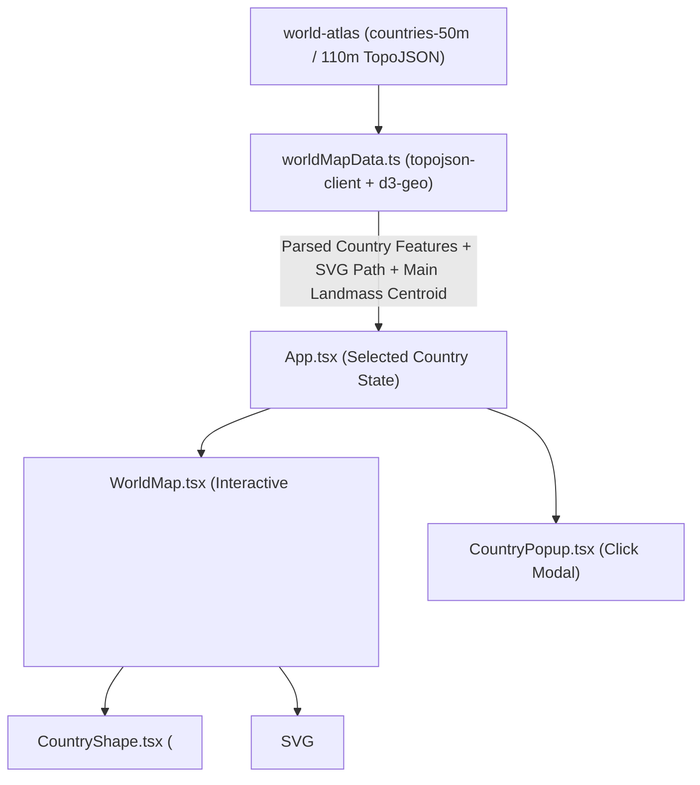

# World History Visual Map — Technical Architecture (`ARCHITECTURE.md`)

> Reference guide for the frontend React SVG map architecture, geographic data pipeline, and backend/TTS integration.

---

## 1. Frontend Architecture (Phase 1: 2D SVG React World Map)

### Key Design Decisions
1. **React Component Per Country (`<CountryShape />`)**:
   - Instead of a static `` or opaque canvas, the map is composed of declarative React SVG components.
   - Each country has its own `<CountryShape />` component rendering an SVG `<path>` with crisp borders (`stroke`) always visible.
2. **Zero Default Text, Dynamic In-Country Hover Label**:
   - When no country is hovered, zero text is rendered on the map.
   - When the user hovers over a country (`hoveredCountry`), an SVG `<text>` label is rendered inside the `<svg>` right at that country's primary polygon centroid `(centroidX, centroidY)`.
   - **MultiPolygon Handling**: For countries with islands or overseas territories (e.g., USA, France, Russia, Indonesia, UK), `worldMapData.ts` calculates the area of each polygon in the `MultiPolygon` and computes the centroid of the **largest polygon**. This guarantees the country name appears inside the main continental territory of the country.
3. **Click Popup (`<CountryPopup />`)**:
   - Clicking any `<CountryShape />` sets `selectedCountry` in `App.tsx`, opening a clean popup modal announcing the country's name.
4. **Interactive Zoom & Pan Controls**:
   - Supports smooth mouse-wheel zoom and drag-to-pan (plus quick `+` / `-` / `Reset` buttons) so even small nations can be inspected comfortably while keeping click vs. drag gestures distinct.

---

## 2. Text-to-Speech (TTS) Engine Module (`code/src/tts/`)
- Preserved from `documents/tts-feature-handoff/`:
  - `code/src/tts/tts.ts` — `synthesizeSpeech()` (Microsoft Edge Neural TTS primary + Google TTS fallback).
  - `code/src/tts/validator.ts` — `validateTextInput()` (English `en` & Persian `fa` detection and validation).
  - `code/src/tts/index.ts` — `convertTextToAudio()` unified barrel export.
- Ready to be wired to a Vite/Node API middleware or backend endpoint when audio narration is requested in upcoming steps.

